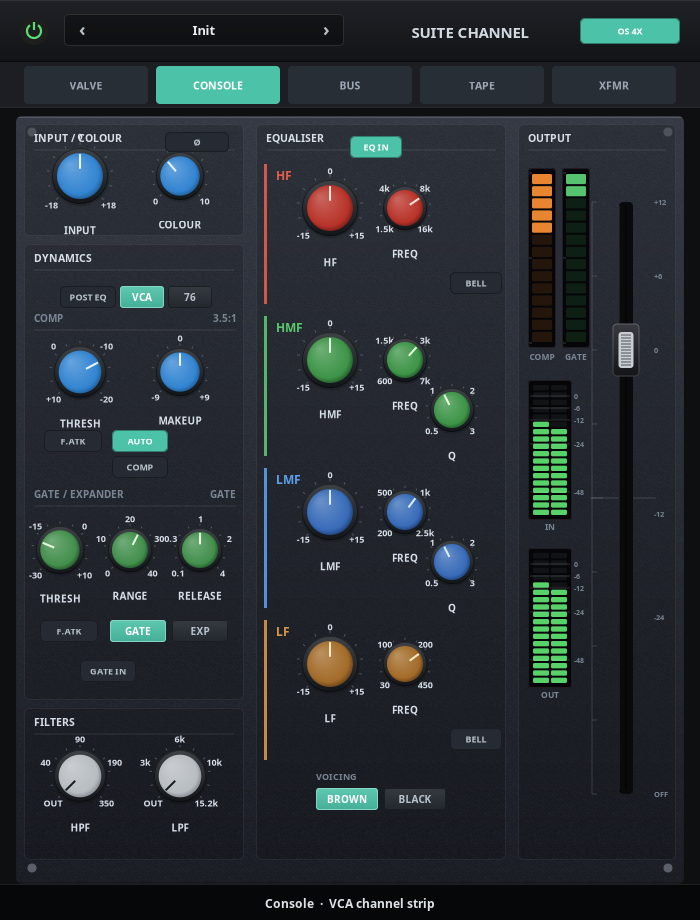
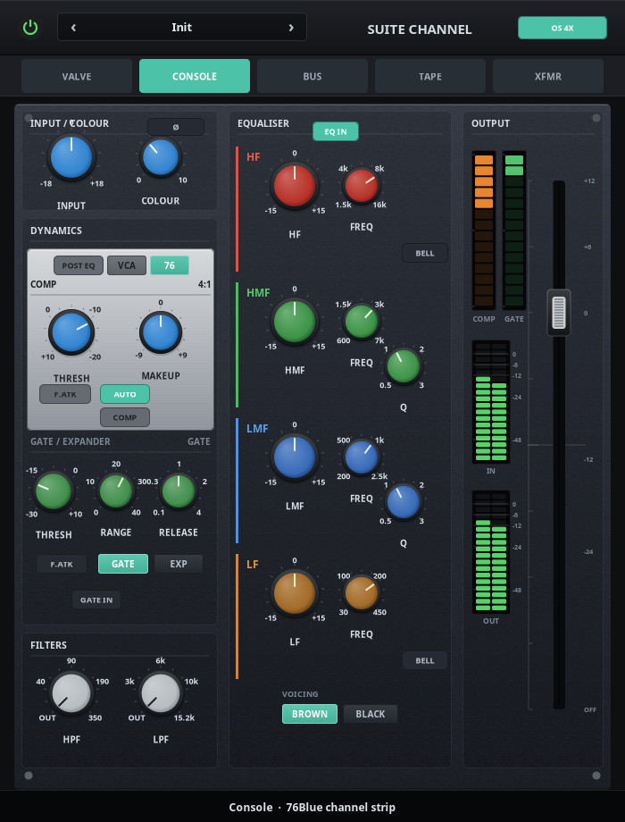
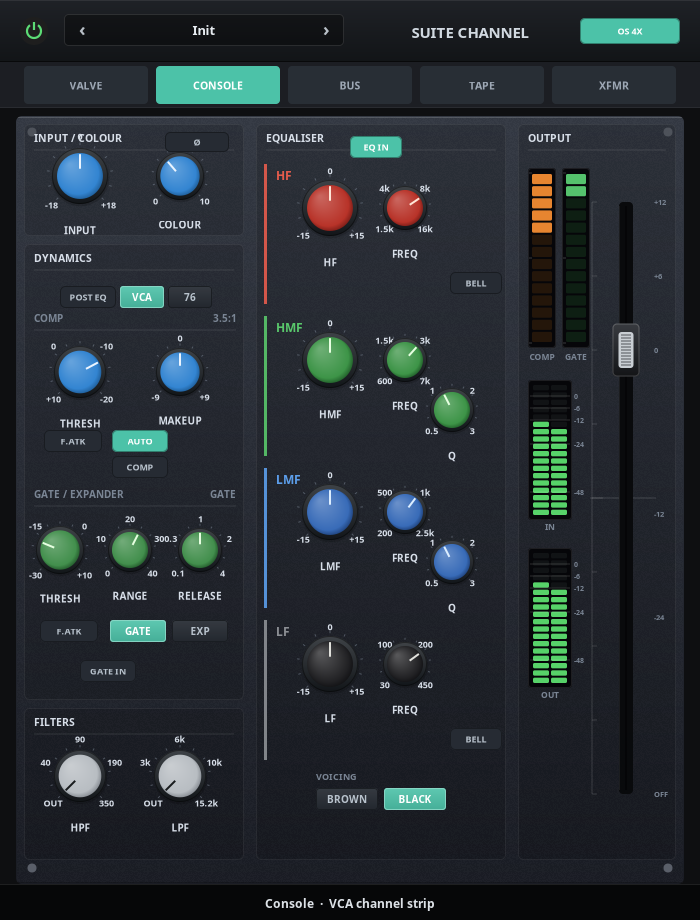

# Suite Channel

**Version 0.1.6** · GPL-3.0-or-later · CLAP + LV2 · Linux

Suite Channel is a vertical SSL-style channel strip in the Comp Suite visual
language. It combines:

- five Patina colour voicings,
- an SSL-style expander/gate,
- a switchable **VCA / 76Blue** compressor with fixed ratios,
- the vendored Dusk **4K EQ 2** four-band console EQ with Brown/Black voicings
  and HPF/LPF,
- a vertical output fader and metering.

The 700×920 strip opens at 1.0× on a 1080p display, and scales down on smaller
screens. It is an independent design. It is not affiliated with or endorsed by
Solid State Logic, Waves, Universal Audio, Dusk Audio, or any hardware
manufacturer.





*76Blue swaps the compressor panel to brushed silver and keeps the same
control surface.*



*Black EQ voicing changes the LF knob fill from tan to black and switches the
DSP to the Black law.*

## Signal flow

```
Input trim → Colour → Gate → Compressor → HPF/LPF → 4-band EQ → Output
```

`DYN POST` moves the gate and compressor after the EQ/filter block.

The Dusk EQ core keeps its own oversampling. The colour stage uses ADAA and the
dynamics are linear gain, so the only reported latency is the EQ oversampler.

## Controls

### Input / Colour

- **Input**: ±18 dB.
- **Colour**: one Amount knob for the selected Patina model. At 0 the stage is
  exact dry; the auto-gain keeps the amount level-neutral.
- Colour tabs: **Valve**, **Console**, **Bus**, **Tape**, **Transformer**.

### Filters

- **HPF**: out, 16–350 Hz.
- **LPF**: out, 15.2 k–3 k.

These are the 4K EQ 2 calibrated filters.

### EQ

- **Brown / Black**: full voicing switch, including different Q and interaction
  laws.
- **LF**: ±15 dB, 30–450 Hz, shelf or bell.
- **LMF**: ±15 dB, 200–2500 Hz, Q 0.5–3.0.
- **HMF**: ±15 dB, 600–7000 Hz, Q 0.5–3.0.
- **HF**: ±15 dB, 1.5–16 kHz, shelf or bell.
- **EQ IN**: constant-latency wet/dry crossfade; the reported latency does not
  change when it is toggled.

### Dynamics

**Compressor**

- **Type**: VCA or 76Blue.
- **VCA**: fixed **3.5:1**, threshold +10…−20 dB, 30 ms attack / 3 ms F.ATK,
  300 ms release, ±9 dB makeup.
- **76Blue**: fixed **4:1**, same control surface, real threshold through the
  FET gain cell, ~0.9 ms / 40 µs F.ATK, ~370 ms release.
- **AUTO**: slow average gain-reduction makeup.
- **F.ATK**: selects the fast attack.
- **COMP**: compressor in/out.

**Expander / Gate**

- **THRESH**: −30…+10 dB.
- **RANGE**: 0–40 dB attenuation floor.
- **RELEASE**: 0.1–4 s.
- **F.ATK**: 1.5 ms / 40 dB or 100 µs / 40 dB.
- **GATE / EXP**: high-ratio gate or fixed 1:2 downward expansion.
- Variable hysteresis prevents chatter; the gate is before the compressor.
- **GATE**: gate in/out.

### Output / metering

- **Output fader**: Off to +12 dB, with 0 dB about 3/4 of the way up.
- **COMP** GR meter (orange), **GATE** GR meter (green).
- Stereo output peak meter.
- Hidden ADAA safety clip at −0.2 dBFS.
- **OS**: Off / 2x / 4x. Default 4x, matching 4K EQ 2. At 88.2/96 kHz 4x is
  capped at 2x; at 176.4/192 kHz it is capped at 1x.
- **PWR**: click-free master bypass.

## Presets

Factory banks: Vocal, Drums, Bass, Guitars, Mix Bus, Utility. Every preset
stores the compressor type and colour model explicitly. Oversampling and power
stay global.

## Build

Requirements: Linux, C++17, CMake ≥ 3.16, `lv2`, `cairo`, `freetype2`, `x11`.

```sh
cmake -S . -B build -DCMAKE_BUILD_TYPE=Release
cmake --build build -j"$(nproc)"
ctest --test-dir build --output-on-failure
```

The CLAP headers, hearth-dsp and the Dusk 4K EQ 2 core are vendored under
`third_party/`.

## Install

```sh
cmake -S . -B build \
  -DCMAKE_BUILD_TYPE=Release \
  -DCLAP_DIR="$HOME/.clap" \
  -DLV2_DIR="$HOME/.lv2"
cmake --build build -j"$(nproc)"
cmake --install build
```

The LV2 bundle is `~/.lv2/suite-channel.lv2`; the CLAP is
`~/.clap/SuiteChannel.clap`.

## URI stability

The LV2 URI is
`https://github.com/tylorismusic-commits/suite-channel`. It embeds the GitHub
path, so renaming the repository or moving the project would break every saved
session. Treat the URI as permanent.

## Current status

0.1.6 puts output unity at 3/4 travel, with +12 dB at the top and off at the
bottom. 0.1.5 gave the output fader a true off position and +12 dB top.
0.1.4 matched the output fader thumb to the Reapertips 27×53 MCP thumb.
0.1.3 cleaned up the gate subheader and control row. 0.1.2 corrected the input
meter to measure after the input trim; 0.1.1 added the stacked stereo input
level meter. CLAP and LV2
load, the editor renders, the DSP runs, the factory presets are generated, and
the state tests cover VCA/76, Brown/Black, presets, expander/gate, power
bypass and all oversampling modes. The remaining gates are the explicit EQ
parity measurement against the upstream Dusk core and the full
Ardour/Carla/REAPER matrix.

## Licence

GPL-3.0-or-later. See `LICENSE` and `THIRD_PARTY_NOTICES.md`.

The vendored Dusk 4K EQ 2 core is GPL-3.0 and is used with attribution. Tukan’s
SumChannel was used only as a behavioural reference; no Tukan code is included.
